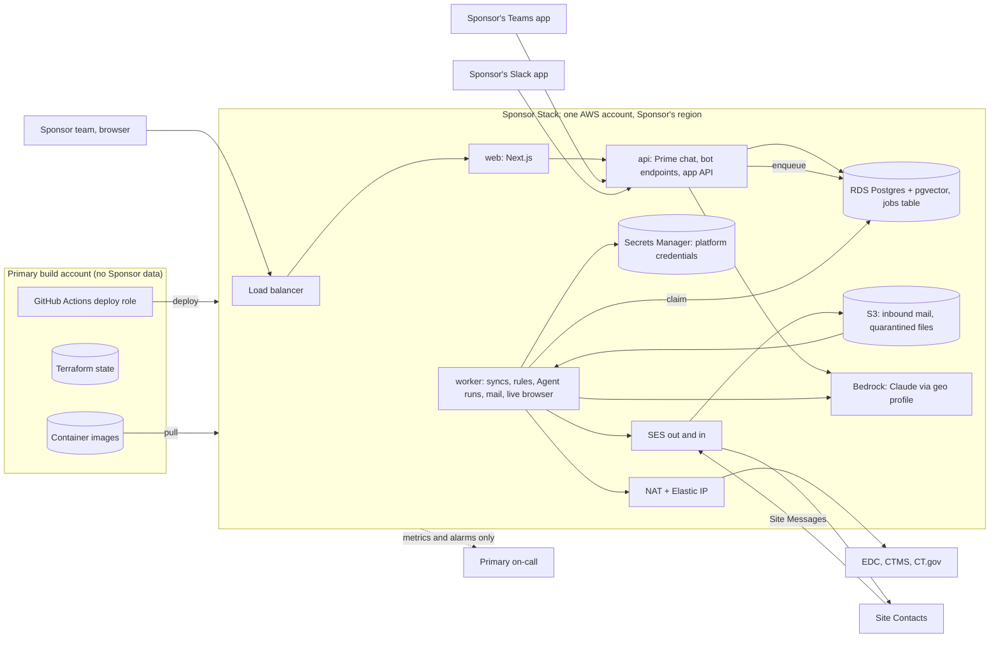

# Deployment architecture

How the Recruitment Control Tower runs for the pilot and after it. Decided in
[Backend architecture and stack](https://github.com/pietrotansini/primary_webapp_v2/issues/8); the hard-to-reverse
part is `docs/adr/0005-a-stack-per-sponsor-in-its-own-aws-account.md`. Hosting facts behind the choices:
`research/agent-deployment-hosting.md` on branch `research/agent-deployment-hosting`. Terms follow `GLOSSARY.md`.

## The shape

Every Sponsor gets its own **Stack**: a complete copy of the platform (web app, Prime, Agents, connectors, database,
mail) in its own AWS account, in the region the Sponsor asks for. Nothing that holds Sponsor data is shared between
Stacks. Each Sponsor has two Stacks:

- **staging**: points at the Sponsor's sandboxes. M1 runs here, and every release lands here first.
- **prod**: real data, from M2.

Primary runs its own **Dev** and **Demo** Stacks from the same Terraform module in Primary-owned accounts, sized
down. The existing `primary_teams` Demo on Vercel keeps running until the new Demo replaces it.

Primary staff who work inside a Sponsor's platform (the Connector reviewer, support) have user accounts in that
Stack. There is no shared Primary console that reads across Stacks.

## Inside a Stack

| Piece | Choice | Notes |
|---|---|---|
| Compute | ECS Fargate, one cluster, three services behind one load balancer | `web` (Next.js standalone), `api` (Prime chat, Teams and Slack endpoints, the app's API), `worker`. Prod runs web and api as 2 tasks across AZs; staging 1. |
| Worker | One service, scales 0 to N on queue depth | Connector syncs (Playwright with headed Chromium), file parsing, metrics and rules, Capability Agent runs, Recipe learning and repair, mail sends and inbound parsing, purge. No duration limit. |
| Database | RDS Postgres with pgvector | Prod Multi-AZ with 35-day point-in-time recovery; staging single-AZ. Holds the Knowledge Base, Prime's LangGraph checkpoints and the jobs table. |
| Jobs and schedules | A Postgres jobs table | Claimed with `FOR UPDATE SKIP LOCKED`; enqueued in the same transaction as the data that caused it (a sync commit, a Site Message, an approval), so a job is never lost or orphaned and is itself an audit record. The worker schedules nightly syncs, CT.gov scans and Campaign sends from the DB. No SQS, Step Functions or hosted workflow service. |
| AI | Amazon Bedrock only, through the geographic cross-region inference profile (`eu.*` for an EU Sponsor) | Every model call: Prime, the Agents, the connector agent, embeddings (moving off Voyage to a Bedrock embedding model). Claude by default; other Bedrock models allowed. No direct Anthropic API, Voyage or Jev in a Sponsor Stack. Bedrock's per-account token quota caps how many Agent runs go in parallel. |
| Prime and Agents | Prime answers in the `api` request; Agent work is a job | Short questions Prime answers itself. When Prime hands work to a Capability's Agent, it enqueues a job and says so; the worker posts the result back to the Surface it came from (an Action, a message in the web chat, Teams or Slack thread). |
| Visible browser | The worker's own headed Chromium, streamed into the Connectors page | Used when a person must act inside a UI Recipe: learning it, an expired session, MFA. The Sponsor admin types into the live view; the session never leaves the Stack. No hosted browser service. |
| Outbound IP | Private subnets, NAT gateway with an Elastic IP | One static IP per Stack for Sponsors who allowlist their platforms. |
| Secrets | AWS Secrets Manager, KMS keys per account | Platform credentials for Recipes, bot secrets, the magic-link signing key. |
| Sign-in | App-owned magic links, mailed through SES | Users live in our DB; SSO is added when a Sponsor asks (roles fog). |
| Mail | Amazon SES, out and in, on a per-Sponsor subdomain | DKIM and SPF on the subdomain; inbound Site Messages land in S3 and become a worker job. SES inbound runs only in some regions: where the Stack's region lacks it, receiving sits in the nearest supported region of the same geography. eu-central-1 and us-east-1 both receive; each new account needs SES production access before mailing Site Contacts. |
| Teams and Slack | A Teams app and a Slack app per Sponsor | Each points at its Stack's `api`. Provisioning registers them; Sponsor IT installs them as line-of-business apps. |
| Logs | CloudWatch in the Stack's account | Logs never leave the account (they may carry Subject IDs). Only metrics and alarms go to Primary's on-call. |

## Across Stacks

- **Provisioning:** Terraform / OpenTofu. One module creates the AWS account in Primary's AWS Organization, one
  creates a Stack in it; they also cover DNS and the Teams and Slack registrations. Scripted before the pilot: the
  pilot Sponsor's staging Stack is its first use, and the module doubles as the reproducible setup the security
  review pack describes.
- **Releases:** one Primary-owned **build account** holds the container registry, Terraform state and the
  GitHub Actions deploy role. It holds no Sponsor data and only pushes code in. A release is one set of image
  digests: CI rolls it to every staging Stack, then to each prod Stack on a manual approval.
- **Engineer access:** through IAM Identity Center only, with time-limited roles; every session is audited. No
  standing database access; a break-glass role exists for it.
- **Repos:** whether the Python backend and the Next.js app share a monorepo is left to the build plan. Either
  way the Python side owns the database migrations and Next.js generates its types from the schema.

## Code boundary

All backend work is Python, growing out of the `primary_teams` agent: Prime, the Capability Agents and their
runtime (A9), rules and metrics, Recipes and Playwright, mail. The Next.js app is the UI plus a thin layer that
reads and writes Postgres for simple screens; anything with AI, a job or an external system goes through the
Python `api`.

## Not decided here

- What polls the jobs table and fires schedules while the worker is scaled to 0 (`api`, or one small worker always
  on). Cost per Stack and Bedrock quotas are researched in `research/stack-cost-bedrock-quotas.md` on branch
  `research/stack-cost-bedrock-quotas` ("Cost and Bedrock quotas per Sponsor Stack", #35).
- SSO: in the roles fog.
