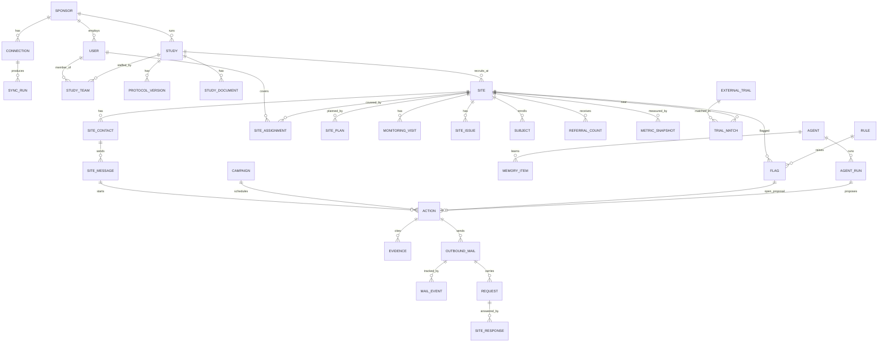

# Data inventory and tentative data model: Recruitment Control Tower

What data the Scenarios need, where we read each item, where it goes, how it is stored and how sensitive it is,
and a first sketch of the entities that hold it. Charted on the wayfinder map
[Wayfinder: Recruitment Control Tower MVP backlog](https://github.com/pietrotansini/primary_webapp_v2/issues/2)
in "Data inventory per Scenario and a tentative data model"
([#22](https://github.com/pietrotansini/primary_webapp_v2/issues/22)). Terms follow `GLOSSARY.md`.

**Status: tentative.** This is the starting point for
"Data ingestion approach for the pilot" ([#7](https://github.com/pietrotansini/primary_webapp_v2/issues/7)), which
decides how each input platform is read, and "High-level data model"
([#9](https://github.com/pietrotansini/primary_webapp_v2/issues/9)), which refines the entities below. Nothing here
is decided until one of those tickets says so. The ranking comes from `docs/scenario-rank.md`, the Scenario details
from `docs/scenarios.md`.

## How sources were chosen

1. **A connected platform first.** For the pilot these are the **EDC** and the **CTMS**: A3 builds connectors for
   them first, and "Vendor data access options for the pilot" found documented APIs (Rave Web Services, Vault EDC
   and CTMS APIs, Clinical One), or the Sponsor's own exports from them.
2. **Then data born on our platform** (Ours): mail we send, Site Messages at our inbound address, Site Responses on
   our hosted pages, Actions, Agent runs, audit events. No integration needed.
3. **Then public APIs** (ClinicalTrials.gov), then **values the Sponsor enters** in a settings screen, then
   **per-study files** (referral tool, eConsent, RTSM, CRO reports). A file needs a per-study spec and often a
   change order, so it comes last.
4. **When two connected platforms hold the same thing**, take the one that is easier to integrate: the CTMS for Study
   and Site facts (one object per Site, no Subject data), the EDC for anything about Subjects. Randomization dates
   come from the EDC, not from the RTSM (Rave aggregates RTSM data; the RTSM itself is file-only).
   **One exception:** enrollment counts. The CTMS Metrics object is the easier read, but EN3 needs Subject milestones
   from the EDC anyway, so counts are computed from those. CTMS Metrics stays the fallback if EDC access comes late.

Every source except Ours is **read-only**: no write-back into EDC, CTMS or any other Sponsor system.

## Vocabulary for the tables

**Input** (where we read it): `EDC`, `CTMS`, `Ours` (born on the platform), `Mail in` (email provider inbound and
delivery webhooks), `Pages` (our hosted Request pages), `CT.gov` (ClinicalTrials.gov API v2), `Sponsor` (entered
in settings), `Upload` (documents the Sponsor uploads), `File` (per-study transfer), `Derived` (computed by us).

**Output** (where it goes once stored):

| Code | Platform | Note |
|---|---|---|
| `App` | Web app screens | Behind sign-in, Study team only |
| `LLM` | Prime and Agents via the Claude API | Disclosed subprocessor, zero data retention |
| `Mail` | Outbound mail to Site Contacts | Leaves our control: only what that Site may see |
| `Chat` | Teams and Slack (D4, Should) | Same rules as `App`, outside our UI |
| `Export` | CSV/PDF downloads, inspection export, end-of-contract export | Every export is audited |

No item is ever written back to a source system.

**Storage:**

- `Synced`: a copy of a source record, kept with its history (one version per change), so Evidence can point
  to the version an Agent read and OP6 can diff two syncs.
- `Born`: created on our platform; we are the system of record.
- `Derived`: recomputed from other items; snapshots kept per sync where Scenarios need trends.
- `Transient`: read during a sync or a run and not kept.

**Retention class:** the Sponsor sets a rolling period per class (A7). A7 names three classes: `Subjects`,
`Site mail` (Site Messages and Site Responses) and `People` (Sponsor users and Site Contacts). This inventory
proposes three more: `Study ops` (synced Study and Site data and our derived figures), `Engagement` (Actions,
Campaigns, sent mail) and `Audit`. Whether `Audit` can be purged on a rolling period is open (Part 11 expects it to
be kept as long as the records it covers).

**Sensitivity:**

| Class | Meaning | Examples |
|---|---|---|
| `Public` | Published by someone else | ClinicalTrials.gov records |
| `Confidential` | The Sponsor's business data, no people in it | Plans, Site performance, costs, protocols |
| `PII` | Personal data of people in a professional role (GDPR personal data) | Site Contacts, Sponsor users, CRAs |
| `Health (pseud.)` | Pseudonymized Subject data: still personal data, special category (GDPR art. 9) | Subject status dates, screen-fail reasons |
| `Free text` | Text we don't control, which may hold patient information | Site Messages, form answers, CTMS issue notes |
| `Secret` | Credentials | Connector users, API keys, file-drop keys |

`Health (pseud.)` items are read-audited (every read by a user or by Prime is logged, ADR 0001). `Free text` items
are classified by the Triage agent, which flags possible patient information (C6). `Secret` items never reach
`LLM` or any output.

**Never ingested:** patient names, initials, dates of birth, contact details and medical record numbers; treatment
arm, kit numbers and anything else that could unblind; CRF data beyond the fields listed under Subjects; RTSM
supply data; invoices and contracts (Budget is Won't). Fields outside the list are dropped while parsing, before
anything is written.

---

## Part 1. Data per Scenario

Item names (`study.plan`, `subject.milestones` and so on) are defined in Part 2.

### Pilot Scenarios (above the cut)

#### 1. EN0 Enrollment by Site report

| Data | Item | Source |
|---|---|---|
| Study code, title, target | `study`, `study.plan` | CTMS |
| Site name, country, status, activation date | `site` | CTMS |
| Screened, consented, randomized per Site, to date and this month | `subject.milestones` → `metric.site` | EDC (fallback: CTMS Metrics) |
| Site target, to show "vs plan" | `site.plan` | CTMS, else Sponsor file |

Output: `App` (report, table), `LLM` (Q&A), `Export` (CSV).

#### 2. EN3 Recruitment blockers at one Site, from referral to randomization

| Data | Item | Source |
|---|---|---|
| Referrals, pre-screen passes and fails, hand-offs to the Site, by week | `referral.funnel` | File (referral tool) |
| Pre-screen failures by question | `referral.prescreen_fails` | File (referral tool) |
| Screened, consented, randomized, discontinued, with dates | `subject.milestones` | EDC |
| Screen-fail reason categories | `subject.screen_fail_reason` | EDC |
| Study median and peer Sites for each stage | `metric.benchmark` | Derived |
| What the Site said about it | `site.message`, `site.response` | Mail in, Pages |
| Open Site issues | `site.issue` | CTMS (optional) |

Output: `App`, `LLM`. Referral and EDC data can't be joined per person (a candidate gets an EDC subject ID only
at screening), so the funnel compares stage counts per period, not cohorts.

#### 3. EN10 Forecast last-patient-in and the cost of delay

| Data | Item | Source |
|---|---|---|
| Target, planned and baseline LPI | `study.plan` | CTMS |
| Per-Site targets and expected pace | `site.plan` | CTMS, else Sponsor file |
| Randomization history per Site (run rate) | `subject.milestones` | EDC |
| Activation dates, and planned dates for Sites not yet active | `site` | CTMS |
| Daily cost of a delay | `study.delay_cost` | Sponsor (settings); CRO cost lines (File) later |
| Forecast LPI, delay, cost of delay | `metric.forecast` | Derived (method: "Enrollment forecasting" fog) |

Output: `App`, `LLM`, `Export`.

#### 4. EN6 Competing trials near a Site, with talking points for the PIs

| Data | Item | Source |
|---|---|---|
| Study condition, phase, key eligibility | `study`, `study.eligibility` | CT.gov record of the Study (by NCT number), else `study.document` |
| NCT number of the Study | `study` | CTMS, else Sponsor |
| Site address and coordinates | `site`, `site.geo` | CTMS, geocoded (Derived) |
| Recruiting trials, their locations and eligibility | `trial.external`, `trial.external_site` | CT.gov |
| Which trials overlap which Site, and how much | `trial.match` | Derived (distance rule, then Agent judgment) |
| Referral trend at the Site, to judge the impact | `referral.funnel` | File (optional) |
| PI to write to | `site.contact` | CTMS |

Output: `App`, `LLM`, `Mail` (talking points to PIs, as an Action).

#### 5. EG7 Draft a one-off communication to a Site

| Data | Item | Source |
|---|---|---|
| Recipients | `site.contact` | CTMS |
| What we know about the Site: flags, diagnoses, figures | `flag`, `agent.run`, `metric.site` | Derived |
| Protocol and Site reference manual passages | `study.document` | Upload (A10) |
| Draft, approval, send | `action`, `mail.outbound` | Ours |
| Sender | `user` | Ours |

Output: `App`, `LLM`, `Mail`.

#### 6. EG8 Plan the monthly Newsletter Campaign with per-Site Reports

| Data | Item | Source |
|---|---|---|
| Recipients per Site | `site.contact` | CTMS |
| Per-Site figures for the Reports (enrollment vs plan, screening this month) | `metric.site`, `site.plan` | Derived, CTMS |
| Open asks and answers per Site | `site.response`, `site.message`, `action` | Ours |
| Protocol milestones and reminders | `study.protocol_version`, `study.plan` | CTMS |
| Campaign, template, blocks, per-Site content | `campaign`, `mail.outbound`, `report` | Ours |

Output: `App`, `LLM`, `Mail`.

#### 7. EG9 Bulk-approve a Campaign, preview it as a Site

| Data | Item | Source |
|---|---|---|
| Per-Site rendered drafts and recipients | `campaign`, `mail.outbound` | Ours |
| Send time in the Site's time zone | `site` (time zone) | CTMS, else Derived from address |
| Approvals with signature meaning | `action`, `audit.event` | Ours |

Output: `App`, `Mail`.

#### 8. EN2.1 Sites at risk against plan, across Studies

| Data | Item | Source |
|---|---|---|
| Randomizations per Site over time | `subject.milestones` → `metric.site` | EDC |
| Expected pace per Site | `site.plan` | CTMS, else Sponsor file (pace method: forecasting fog) |
| Activation date | `site` | CTMS |
| Rules, severities, flags | `rule`, `flag` | Ours (config), Derived |
| Diagnosis, proposed Action, Evidence, memory | `agent.run`, `evidence`, `action`, `agent.memory` | Ours |
| Saved weekly check | `saved_check` | Ours |

Output: `App`, `LLM`, `Chat` (weekly check, later).

#### 9. EG5 Brief for the next Site meeting

| Data | Item | Source |
|---|---|---|
| Last and next monitoring visits | `site.visit` | CTMS |
| Open Site issues | `site.issue` | CTMS |
| Enrollment and funnel figures | `metric.site` | Derived |
| Recent Site Messages and Site Responses | `site.message`, `site.response` | Ours |
| Open Actions for the Site | `action` | Ours |
| Who attends | `site.contact`, `site.assignment` | CTMS |
| The brief | `brief` | Ours |

Output: `App`, `LLM`, `Export` (no "Saved to CTMS": no write-back).

### Below the cut

Same rules, one row each. Items in **bold** are the ones not already needed by a pilot Scenario.

| Rank | Scenario | Items needed | New sources |
|---|---|---|---|
| 10 | EN2.2 Rank Sites by enrollment gap | `study.plan`, `site.plan`, `subject.milestones`, `metric.site` | |
| 11 | EN1 Why a Study is behind plan | `study.plan`, `site.plan`, `subject.milestones`, `subject.screen_fail_reason`, `referral.funnel`, `metric.benchmark` | |
| 12 | EN2.3 Compare each Site with the study median | `referral.funnel`, `subject.milestones` (consent date from EDC, not eConsent), `metric.benchmark` | |
| 13 | EN4.1 Screen fails on a lab criterion | `subject.screen_fail_reason`, **`subject.lab_dates`**, `site.message` | EDC lab dates (widens ADR 0001) |
| 14 | EN4.2 Staff turnover cut referrals | `site.contact` (start/end dates), `referral.funnel`, **`study.external_contact`** (the CRO) | CTMS |
| 15 | EN4.3 Activated, no first patient | `site` (activation date), `subject.milestones` | |
| 16 | EN4.4 Candidates drop at consent | `subject.milestones` (screened vs consented); participant feedback has no source | |
| 17 | EN4.5 Few referrals reach screening | `referral.funnel`, `subject.milestones` | |
| 18 | EN4.6 Few referred candidates are eligible | `referral.prescreen_fails`, `subject.screen_fail_reason` | |
| 19 | EN4.7 Early withdrawals | `subject.milestones`, **`subject.discontinuation_reason`** | EDC (widens ADR 0001) |
| 20 | EN4.8 Stopped screening for N weeks | `subject.milestones` | |
| 21 | EN5 Sites that can take more patients | `site.plan`, `subject.milestones`, **`site.capacity`** | Pages (a Site Response form) |
| 24 | EN8 Draft a recovery plan | `agent.run`, `flag`, `action` | |
| 25 | EN9 Did an Action work? | `metric.site` history, `action` | |
| 26 | EG1 Re-engage quiet Sites | `site.message`, `site.response`, **`mail.event`**, `metric.site`, **`metric.engagement`** | Mail in (delivery webhooks) |
| 27 | EG2 Thank the top-recruiting Sites | `metric.site`, `site.plan`, `site.contact` | |
| 28 | EG3 Protocol reminder with a deadline | `study.protocol_version`, **`subject.consent_version`**, `site.contact` | EDC (widens ADR 0001); eConsent file only if the EDC lacks it |
| 29 | EG4 Repeated Site questions into an FAQ | `site.message`, `study.document` | |
| 30 | EG6 Site issues into CRA follow-ups | `site.issue`, `site.visit`, `site.assignment`, `user` | |
| 31 | EG10 A Site acknowledges a Request | **`request`**, `site.response` | |
| 32 | EG11 A Site replies by email | `site.message`, `action` | |
| 33 | EG12 Campaign performance | `campaign`, `mail.event`, `site.response`, `site.message`, `metric.site` | |
| 34 | EG13 Campaigns that led to randomizations | `mail.outbound`, `subject.milestones` | |
| 35 | EG14 Automate weekly Site check-ins | `agent`, `saved_check`, `campaign` | |
| 36 | OP1 What needs my attention today | `action`, `agent.run`, `campaign` | |
| 37 | OP2 Weekly update for study leadership | `audit.event`, `metric.site`, `study.plan` | |
| 38–41 | OP3.1–OP3.4 Rank, assign, chase, reject Actions | `action`, `user`, `study.team`, `agent.memory` | |
| 42 | OP4 Sites that need a monitoring visit | `site.visit`, **`edc.query`**, `metric.site` | EDC |
| 43 | OP5.1 Queries open for 30+ days | **`edc.query`** | EDC |
| 44 | OP5.2 EDC data-entry lag | **`edc.entry_lag`** | EDC |
| 45 | OP5.3 Overdue monitoring visit reports | `site.visit` | |
| 46 | OP6 What changed in CTMS since the last sync | history of every `Synced` CTMS item, `sync.run` | |
| 47 | OP7 Visit load against Site resources | **`subject.next_visit`**, **`study.visit_schedule`**, `site.message`; device and coordinator-hour counts have no source | EDC (ODM study design) |
| 48 | OP8 Tune an Agent | `agent`, `agent.run`, `agent.memory` | |
| 49 | OP9.1 What Prime did this week | `audit.event`, `agent.run` | |
| 50 | OP9.2 Export approvals for an inspection | `audit.event` | |
| 51 | OP9.3 Which connections need attention | `connection`, `sync.run` | |

Won't and Out Scenarios (EN7, OP10, BU, RG, TM) add invoices, contracts, payment runs, campaign-tool spend,
eIRB approvals, RTSM supply and eTMF documents. None of these is ingested.

---

## Part 2. Data items, by category

One row per item. **Scenarios** lists the pilot Scenarios in bold, then the first few below the cut ("and more" when
others follow). Retention class and audit are in **Storage**.

### 1. Study

| Item | Fields | Scenarios | Input | Output | Storage | Sensitivity |
|---|---|---|---|---|---|---|
| `study` | study code, title, phase, condition, countries, status, NCT number | **all** | CTMS (NCT: CTMS, else Sponsor) | App, LLM, Mail, Export | Synced · Study ops | Confidential |
| `study.plan` | target randomizations, planned and baseline FPI/LPI, planned Site count | **EN0, EN10, EG8, EN2.1**, EN1, EN2.2, OP2 | CTMS | App, LLM, Export | Synced · Study ops | Confidential |
| `study.protocol_version` | version, approval date, re-consent required | **EG8**, EG3 | CTMS | App, LLM, Mail | Synced · Study ops | Confidential |
| `study.eligibility` | key inclusion and exclusion criteria (text) | **EN6** | CT.gov (Study's own record), else from `study.document` | App, LLM, Mail | Synced · Study ops | Public or Confidential |
| `study.document` | protocol, Site reference manual, approved FAQs: file, version, text chunks | **EG7**, EG4 | Upload (A10) | App, LLM, Mail (quoted) | Born · Study ops | Confidential |
| `study.delay_cost` | daily cost of delay, currency | **EN10** | Sponsor; CRO cost lines (File) later | App, LLM | Born · Study ops | Confidential |
| `study.visit_schedule` | visits, windows, procedures | OP7 | EDC (ODM study design) | App, LLM | Synced · Study ops | Confidential |
| `study.team` | Sponsor users on the Study and their role | **EG7, EN2.1**, OP3.2, EG6 | Ours (A1) | App, LLM | Born · People | PII |
| `study.external_contact` | CRO or vendor contacts we may write to | EN4.2 | CTMS, else Sponsor | App, LLM, Mail | Synced · People | PII |

### 2. Sites and people

| Item | Fields | Scenarios | Input | Output | Storage | Sensitivity |
|---|---|---|---|---|---|---|
| `site` | CTMS site ID, site number, institution, address, country, time zone, status, planned and actual activation dates, close date | **all** | CTMS | App, LLM, Mail, Export | Synced · Study ops | Confidential |
| `site.geo` | coordinates | **EN6** | Derived (geocoder on the address) | App, LLM | Derived · Study ops | Confidential |
| `site.plan` | Site target, expected randomizations per month | **EN0, EN10, EG8, EN2.1**, EN1, EN2.2, EN5, EG2 | CTMS if held, else Sponsor file | App, LLM, Mail (in Reports) | Synced · Study ops | Confidential |
| `site.contact` | name, role (PI, coordinator, …), email, phone, start and end dates | **EN6, EG7, EG8, EG9, EG5**, EN4.2, EG2, EG3 | CTMS | App, LLM, Mail | Synced · People | PII |
| `site.assignment` | Sponsor-side CRA or monitor per Site | **EG5**, EG6, OP3.2 | CTMS, matched to `user` | App, LLM | Synced · People | PII |
| `site.visit` | monitoring visit type, planned and actual date, report due and final dates | **EG5**, EG6, OP4, OP5.3 | CTMS | App, LLM | Synced · Study ops | Confidential |
| `site.issue` | category, opened, due, status, description | **EG5, EN3**, EG6 | CTMS | App, LLM | Synced · Study ops | Free text |
| `site.capacity` | screening slots a Site says it can take | EN5 | Pages (Site Response form) | App, LLM | Born · Site mail | Confidential |

### 3. Subjects (pseudonymized)

Each new field here widens ADR 0001 (`docs/adr/0001-store-pseudonymized-subject-records.md`), which lists EDC
subject ID, Site, status and status dates, screen-fail reason category and next visit date.

| Item | Fields | Scenarios | Input | Output | Storage | Sensitivity |
|---|---|---|---|---|---|---|
| `subject` | EDC subject ID, Site, current status | **EN0, EN3, EN10, EN2.1, EG5** and more | EDC | App, LLM, Export | Synced · Subjects · read-audited | Health (pseud.) |
| `subject.milestones` | screened, consented, randomized, discontinued and completed dates | **EN0, EN3, EN10, EN2.1** and more | EDC (randomization: EDC, not RTSM) | App, LLM, Export; Mail only as counts | Synced · Subjects · read-audited | Health (pseud.) |
| `subject.screen_fail_reason` | reason category | **EN3**, EN1, EN4.1, EN4.6 | EDC | App, LLM; Mail only as counts | Synced · Subjects · read-audited | Health (pseud.) |
| `subject.next_visit` | next (and last) visit date | OP7 | EDC | App, LLM | Synced · Subjects · read-audited | Health (pseud.) |
| `subject.discontinuation_reason` | reason category (**not in ADR 0001**) | EN4.7 | EDC | App, LLM | Synced · Subjects · read-audited | Health (pseud.) |
| `subject.consent_version` | ICF version signed, date (**not in ADR 0001**) | EG3 | EDC, else eConsent File | App, LLM | Synced · Subjects · read-audited | Health (pseud.) |
| `subject.lab_dates` | screening lab collection and result dates (**not in ADR 0001**) | EN4.1 | EDC | App, LLM | Synced · Subjects · read-audited | Health (pseud.) |

### 4. Referral funnel

Pre-screened candidates have not consented to the Study and have no pseudonymized ID, so we propose taking
**counts only**: no per-candidate rows, and names and contacts never reach us.

| Item | Fields | Scenarios | Input | Output | Storage | Sensitivity |
|---|---|---|---|---|---|---|
| `referral.funnel` | counts per Site, week, source channel and stage (referred, pre-screen passed, failed, handed to Site, scheduled) | **EN3, EN6**, EN1, EN2.3, EN4.2, EN4.5 | File (referral tool) | App, LLM, Mail (in Reports) | Synced · Study ops | Confidential |
| `referral.prescreen_fails` | fail counts per pre-screen question, Site and week | **EN3**, EN4.6 | File (referral tool) | App, LLM | Synced · Study ops | Confidential |

### 5. EDC operations

| Item | Fields | Scenarios | Input | Output | Storage | Sensitivity |
|---|---|---|---|---|---|---|
| `edc.query` | Site, form, opened, answered, closed, status (query text dropped) | OP4, OP5.1 | EDC | App, LLM | Synced · Study ops | Confidential |
| `edc.entry_lag` | per Site: visit date vs first entry date, missing pages | OP5.2 | EDC | App, LLM | Derived · Study ops | Confidential |

### 6. External signals

| Item | Fields | Scenarios | Input | Output | Storage | Sensitivity |
|---|---|---|---|---|---|---|
| `trial.external` | NCT number, title, conditions, phase, status, sponsor, eligibility, dates, last update | **EN6** | CT.gov | App, LLM, Mail | Synced · Study ops | Public |
| `trial.external_site` | facility, city, country, coordinates, recruiting status | **EN6** | CT.gov | App, LLM, Mail | Synced · Study ops | Public |
| `trial.match` | Site, trial, distance, overlap judgment, first seen | **EN6** | Derived | App, LLM, Mail | Derived · Study ops | Confidential |

### 7. Engagement

| Item | Fields | Scenarios | Input | Output | Storage | Sensitivity |
|---|---|---|---|---|---|---|
| `action` | kind, Study, Sites, owner, deadline, status, priority, impact line, email draft, origin (run, Site Message, user), approval (who, when, meaning), rejection reason | **EG7, EG8, EN2.1, EG5** and more | Ours | App, LLM, Mail (the email), Chat, Export | Born · Engagement | Confidential, PII in drafts |
| `campaign` | Study, template, blocks (shared or personal), audience, schedule, status | **EG8, EG9**, EG12, EG14 | Ours | App, LLM | Born · Engagement | Confidential |
| `mail.outbound` | per-Site rendered mail, recipients, sender, scheduled and sent time, provider message ID | **EG7, EG8, EG9**, EG13 | Ours | Mail, App, Export | Born · Engagement | PII (recipients) |
| `mail.event` | delivered, bounced, opened, clicked, per message | EG1, EG12 | Mail in (delivery webhooks) | App, LLM | Born · Engagement | PII |
| `report` | figures and text per Site and period, as sent | **EG8** | Derived | Mail, App | Derived · Engagement | Confidential |
| `request` | kind (acknowledge, short form), form fields, link token | **EG8**, EG10 | Ours | Mail, Pages | Born · Engagement | Confidential |
| `site.response` | request, Site Contact, answer, time | **EN3, EG8, EG5**, EG1, EG10, EG12 | Pages | App, LLM | Born · Site mail | Free text |
| `site.message` | sender, recipients, subject, body, attachments, received time, thread, matched Site and Site Contact, classification, patient-information flag | **EN3, EG8, EG5**, EN4.1, EG1, EG4, EG11 | Mail in (inbound address) | App, LLM | Born · Site mail | Free text, PII |
| `metric.engagement` | engagement score per Site and date (formula: "Engagement score" fog) | EG1 | Derived | App, LLM | Derived · Engagement | Confidential |
| `brief` | Site, meeting date, text, Evidence | **EG5** | Ours | App, Export | Born · Engagement | Confidential |

### 8. Insights and Agents

| Item | Fields | Scenarios | Input | Output | Storage | Sensitivity |
|---|---|---|---|---|---|---|
| `metric.site` | per Site and sync: counts per stage, rates, expected, gap, status, bottleneck | **EN0, EN3, EG7, EG8, EN2.1, EG5** and more | Derived (from `subject.milestones`, `site.plan`, `referral.funnel`) | App, LLM, Mail (in Reports), Export | Derived, snapshot per sync · Study ops | Confidential (aggregates of health data) |
| `metric.benchmark` | study median and peer percentiles per stage | **EN3**, EN1, EN2.3 | Derived | App, LLM | Derived · Study ops | Confidential |
| `metric.forecast` | projected LPI, delay in days, cost of delay, method | **EN10** | Derived | App, LLM, Export | Derived, snapshot per sync · Study ops | Confidential |
| `rule` | metric, threshold, severity, Agent | **EN2.1** | Ours (config) | App | Born · Study ops | Confidential |
| `flag` | rule, Site, severity, opened, state, cool-down until | **EG7, EN2.1**, EN8 | Derived | App, LLM | Derived · Study ops | Confidential |
| `agent` | Capability, instructions, schedule | **EN2.1**, OP8, EG14 | Ours | App, LLM | Born · Study ops | Confidential |
| `agent.run` | trigger, flags handled, tool reads, run summary, diagnosis lines, LLM calls | **EG7, EN2.1, EG5** and more | Ours | App, LLM | Born · Study ops; holds Subject reads, so audited | Mixed (as sensitive as what it read) |
| `evidence` | record type, record ID, record version, source system, as-of sync time | **EN2.1** and every Agent proposal | Ours | App | Born · Engagement | Confidential (pointers only) |
| `agent.memory` | Study, Agent, text, origin (rejection reason) | **EN2.1**, OP3.4, OP8 | Ours | App, LLM | Born · Study ops | Confidential |
| `saved_check` | question, schedule, owner | **EN2.1**, EG14 | Ours | App, Chat | Born · Study ops | Confidential |
| `prime.conversation` | question, plan, tool reads, answer, surface (web, Teams, Slack) | **all Ask Scenarios** | Ours | App, Chat | Born · Engagement; audited when it read Subjects | Mixed |

### 9. Platform and compliance

| Item | Fields | Scenarios | Input | Output | Storage | Sensitivity |
|---|---|---|---|---|---|---|
| `sponsor` | name, settings, retention periods, region | all (tenancy) | Ours | App | Born | Confidential |
| `user` | name, email, role, Studies, status | **EG7**, OP3.2, EG6 | Ours (A1) | App, LLM (names only), Mail (as sender) | Born · People | PII |
| `connection` | system, vendor, mode (API, file), status, credentials reference | OP9.3 | Ours | App (status only) | Born; credentials in a secret store | Secret (credentials), Confidential |
| `sync.run` | connection, start and end, status, records read and dropped, file checksum, errors | OP6, OP9.3 | Ours | App, LLM | Born · Audit | Confidential |
| `audit.event` | who, when, what, before and after, signature meaning | OP2, OP9.1, OP9.2; required by every Scenario | Ours | App, LLM (summaries), Export | Born · Audit, append-only | Mixed (may cite Subject IDs) |

---

## Part 3. Tentative data model

### Layers

1. **Landing (Transient).** Files and API payloads as received. Parsed, filtered to the fields above, then deleted;
   only the manifest and a checksum stay on `sync.run`. Raw exports can't be kept because they hold Subject fields
   ADR 0001 says to drop at ingestion.
2. **Synced records.** Our canonical copy of EDC, CTMS, CT.gov and file data, one row per version (valid from and
   to, `sync.run` that wrote it). Evidence points at a version; OP6 diffs two syncs.
3. **Derived.** Metrics, benchmarks, forecasts, flags, matches and Reports, recomputed after each sync and
   snapshotted.
4. **Born.** Engagement, Agents and platform records: we are the system of record.

Every row carries `sponsor_id` (one Sponsor in the pilot, ready for more) and, where it applies, `study_id`.

### Entities and relationships

`SITE` belongs to one `STUDY`: an institution that recruits for two Studies is two Sites, as in the CTMS. Whether
to add an `INSTITUTION` above it (to show one hospital across Studies) is left to the data model ticket.
`AUDIT_EVENT` is left out of the diagram; it references any entity.

### Stored vs derived

- **Stored from sources:** Study, protocol versions, Site, Site plan, Site Contact, Site assignment, monitoring
  visits, Site issues, Subjects with their milestone dates and reason categories, referral counts, EDC queries,
  external trials and their locations.
- **Entered by the Sponsor:** NCT number when the CTMS lacks it, daily cost of delay, retention periods, Study
  documents.
- **Born on the platform:** users and Study team, Actions, Campaigns, outbound mail and its events, Requests,
  Site Responses, Site Messages, Agents, runs, memory, saved checks, conversations, connections, sync runs, audit.
- **Derived:** Site metrics, benchmarks, forecast, engagement score, flags, trial matches, Reports, entry lag,
  coordinates.

---

## Open questions

For **Data ingestion approach for the pilot**:

- Does the pilot Sponsor's CTMS hold **per-Site plans** (target, expected monthly randomizations)? If not, take a
  Sponsor spreadsheet, or derive a straight line from the Site target and activation date.
- **Referral tool:** which tool, and can it export counts per Site, week and stage, so no per-candidate data
  reaches us?
- **Landing:** confirm raw files are deleted after parsing (manifest and checksum only), and how a failed parse is
  debugged without them.
- **Geocoding** Site addresses for EN6: which provider, and whether Site addresses may be sent to it.
- **NCT number:** is it in the CTMS Study record?

For **High-level data model**:

- **ADR 0001 widening:** discontinuation reason category (EN4.7), ICF version (EG3), screening lab dates (EN4.1).
  None is needed above the cut, so ADR 0001 can stay as it is for now.
- **Retention classes:** adopt `Study ops`, `Engagement` and `Audit` next to A7's three? Can `Audit` be purged on
  a rolling period?
- **Versioned synced records:** confirm one row per version for every synced entity (needed by Evidence and OP6).
- **Site vs Institution:** one Site per Study, or an Institution above it.
- **What reaches `Mail`:** Subject IDs never, figures per Site only. Can a Report show counts below a minimum
  (such as 1 screen fail) to the Site that produced them?
- **Free text from the CTMS** (`site.issue` descriptions): keep them, or keep the category only?
